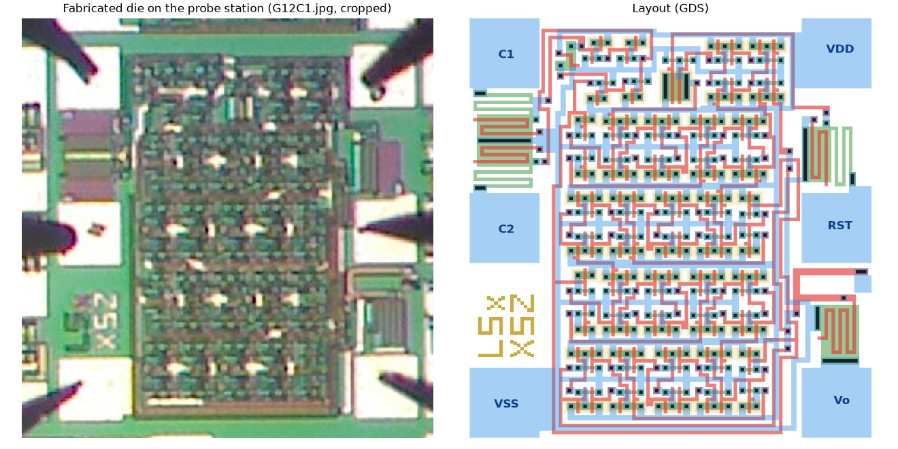
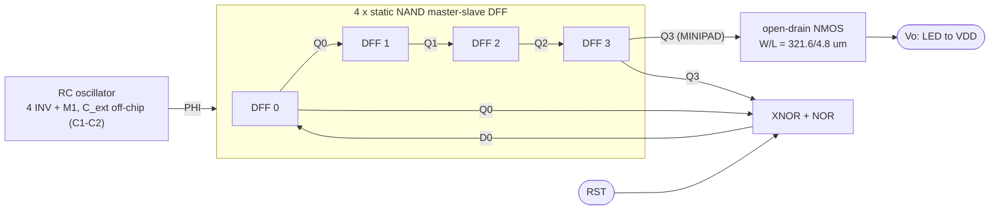
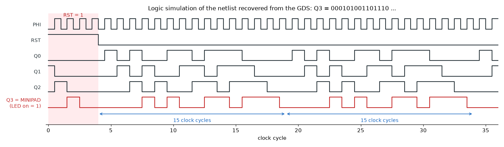
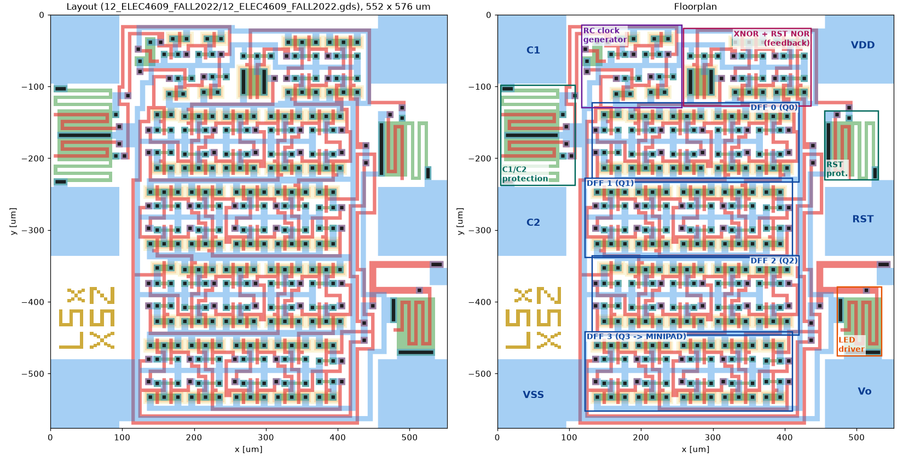
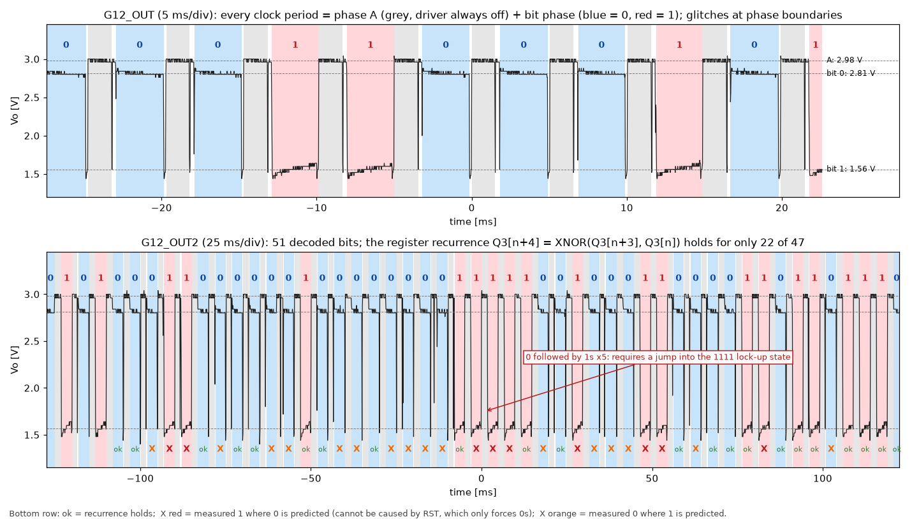
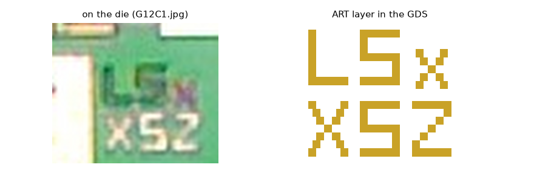

# ELEC 4609 Project: Static Logic PRSG

A pseudo-random LED flasher chip (for a bicycle taillight), designed, taped out
and measured in **ELEC 4609, Integrated Circuit Design and Fabrication**, at
Carleton University, Fall 2022. It is a 4-bit linear-feedback shift register
built from static NAND master-slave flip-flops, clocked by an on-chip RC
oscillator, with an open-drain LED driver, in the Carleton University SOI process.



## At a glance

| | |
|---|---|
| Function | 4-bit PRSG: XNOR(Q0, Q3) feedback, maximal length 15, RST to escape the 1111 lock-up |
| Process | Carleton University SOI (CUSOI): fully depleted 100 nm film on 400 nm buried oxide, 25 nm gate oxide, lambda = 2.4 um (L = 4.8 um), one metal + poly, 5 masks |
| Size | 552 x 576 um: a 230 x 240 lambda frame including six 96 um probe pads |
| Transistors | 177 (91 NMOS + 86 PMOS) = 36 NAND2 + 12 INV + 1 NOR2 + 5 discrete NMOS |
| Supply | 3 V (two AA cells) |
| Tools | Cadence Virtuoso, Calibre DRC/LVS |
| Sign-off | DRC: 0 violations in 36 checks. LVS: CORRECT (2022-10-15) |
| Silicon (Nov 2022) | The oscillator runs (1.30 kHz with 10 nF) and the output toggles once per clock, but the measured bit stream is **not** the designed sequence ([details](#post-fabrication-results)) |

## How it works



- **Clock:** the classic two-inverter CMOS RC oscillator plus buffers. The timing
  capacitor sits off-chip between pads C1 and C2, and an always-on NMOS (M1)
  is the feedback resistor.
- **Register:** four textbook static master-slave D flip-flops (8 NAND2 + 2 INV
  each), positive-edge triggered. The spec allowed 4 stages instead of 5 when
  the static flip-flops do not fit.
- **Feedback:** XNOR(Q0, Q3) from four NAND2s, followed by a NOR with RST. The
  polynomial is x^4 + x^3 + 1, which is primitive, so the output repeats every
  15 clocks: `000101001101110`. RST shifts in zeros to escape the all-ones
  lock-up state.
- **Output:** Q3 drives a 321.6 um wide open-drain NMOS that sinks the LED
  current. The same node goes to a mini probe pad.



More detail, including the spec-vs-implementation table and transistor sizes:
[**docs/design.md**](docs/design.md).

## Layout



- The four flip-flops are stacked in the centre. Two mirrored DFF cells
  alternate so the data path snakes from stage to stage.
- The clock generator and the feedback logic sit on top. Pad protection
  (grounded-gate NMOS + diffusion resistors) is next to C1/C2 and RST, and the
  LED driver is next to Vo.
- There is only one metal layer, so every crossing needs a poly jumper, which
  makes the routing very dense.

## Verification

- **At tape-out:** Calibre DRC is clean and Calibre LVS is CORRECT
  ([`12_ELEC4609_FALL2022/`](12_ELEC4609_FALL2022/README.md)).
- **Afterwards, with open-source tools only** ([`analysis/`](analysis/README.md)):
  - The GDS was re-extracted with KLayout. It gives exactly the same 7 ports,
    91 nets, 91 NMOS and 86 PMOS as the Calibre report.
  - The transistors were regrouped into a gate-level netlist with meaningful net
    names, which confirms the 4-stage XNOR(Q0, Q3) register.
  - A unit-delay simulation shows the 15-cycle sequence; 1111 is the only
    lock-up state, and RST escapes it.

Details: [**docs/verification.md**](docs/verification.md).

## Post-fabrication results



- **The oscillator works**, which was not a given on this run: according to the
  course notes, several PRBS designs had no clock at all. It scales with the
  external capacitor: 1.30 kHz with 10 nF and 223 Hz in a second capture. The
  ~10 Hz flash target would need about 1.3 uF, because M1 was drawn short and
  wide (W/L = 6) rather than as the L/W = 20 resistor in the spec.
- **The output switches** between 2.81 V and 1.56 V once per clock (~201 Hz). In
  every period, a clock-synchronous phase (about a third of the period) holds the
  output off, and there are glitches at the phase boundaries.
- **The sequence is wrong.** 51 consecutive clock periods were decoded. The
  register recurrence holds for only 22 of 47 bits, there is no period-15
  repetition, and the stream contains a 0 followed by five 1s. That last pattern
  needs a jump into the 1111 lock-up state, which a fault-free register cannot
  make with or without RST. So the register was being upset during these
  captures.
- **The other static-PRSG design on the same die fared no better on the on-chip
  clock.** In the course's test data from the same sessions, its output did not
  run at all: only clock ripple. In December it was re-tested with an
  **externally injected clock** and produced a clean, correct 5-bit sequence.
  This chip was never tested that way.
- **The most likely main cause is therefore the clocking**, which both static
  designs share: the RC oscillator has no hysteresis and drives single-phase
  static master-slave flip-flops. Layout details specific to this chip may have
  added to it:
  - the clock is routed on about 1.4 mm of poly, in the same direction as the data;
  - for about 0.9 mm it runs alongside the output node at minimum spacing;
  - the output latch is unbuffered.

  An external-clock test would have separated these causes.

Details: [**docs/post_fab_test.md**](docs/post_fab_test.md).

## Lessons learned

> It turns out that being too spatially optimized is not a good thing for chip
> fab and performance. This highly compact layout design leads to poor signal
> output later in the post-fab test. So play safe, don't push it too far. :sweat:

What the later analysis adds, from the GDS, the saved data, the course notes and
the course's posted test data:

- **If the on-chip clock misbehaves, inject one.** The handout allowed an
  external clock at C2. With one, the other static design produced a perfect
  sequence. This chip was never tried that way, so its logic is still untested.
- **Static flip-flops need a clean clock.** Add hysteresis to the RC oscillator.
  Generate non-overlapping phases instead of relying on a local inverter pair.
  Size the timing device for the target frequency: M1 as drawn puts 10 Hz out
  of reach of the planned capacitors.
- **Give the clock the metal.** With one metal layer and a dense core, PHI ended
  up on about 8,000 um² of poly against 432 um² of metal
  ([figure](docs/img/layout_clock_net.png)). It runs in the same direction as
  the data, and for about 0.9 mm right next to the output node.
- **Buffer the output.** The course checklist asked for one. Here a minimum-size
  latch output drives the 321 um wide LED driver directly.
- **Use the space you are given.** The static project was allotted more area than
  the dynamic one. The other static design used about twice this block's width.
- **Log the setup.** Record VDD, the substrate bias, the LED supply and resistor,
  the probe attenuation and `C_ext` with every capture.

## The art on the die

When the instructor said leftover die area could carry personal artwork, I used
it for **LS × XSZ**: my initials and my girlfriend's. That last semester was a
hard one, and she is the one who kept me going.



It sits on the left edge, between the C2 and VSS pads. "LS" is drawn in poly,
the "×" in silicon (DWELL) and "XSZ" in metal, which is why XSZ is the
brightest part of the photo.

## Repository layout

```
README.md
ELEC4609_Project_StaticPRSG_F2022.pdf   course handout (project specification)
G12C1.jpg, G12C2.jpg, G12C3.jpg         die photos on the probe station
12_ELEC4609_FALL2022/                   tape-out package: GDS, Calibre DRC/LVS reports, library archive
Libv2_langsun_4609fall2022/             Cadence Virtuoso library, tape-out version
Libv1_langsun_4609fall2022/             earlier snapshot of the same library
post_fab_test/                          raw oscilloscope captures (CSV, screenshot, scope setup)
docs/
  design.md                             spec, architecture, circuits, sizing, layout
  verification.md                       Calibre DRC/LVS + independent re-extraction + logic simulation
  post_fab_test.md                      analysis of the oscilloscope captures
  cadence_libraries.md                  what is in the two Cadence libraries
  img/                                  generated figures
analysis/                               Python scripts that regenerate analysis/results/ and docs/img/
```

## Reproducing the analysis

```sh
uv run analysis/run_all.py
```

This needs only Python with KLayout, NumPy and Matplotlib. No Cadence, Calibre
or PDK. See [`analysis/README.md`](analysis/README.md).
