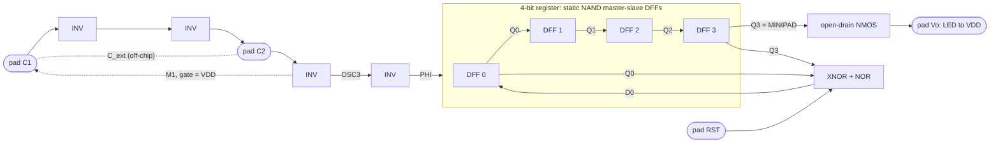
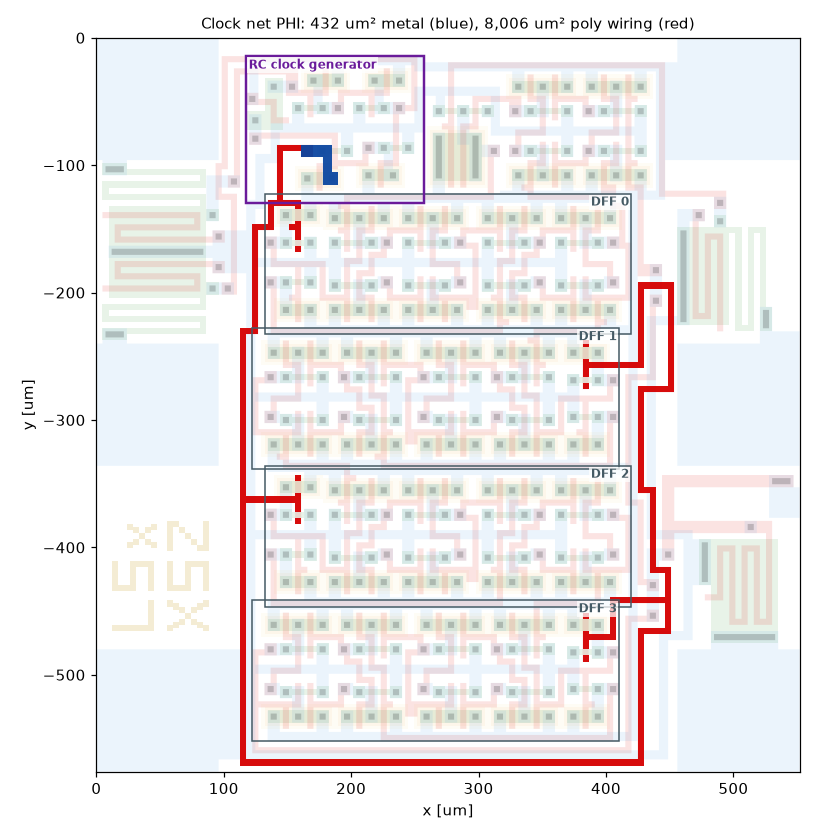
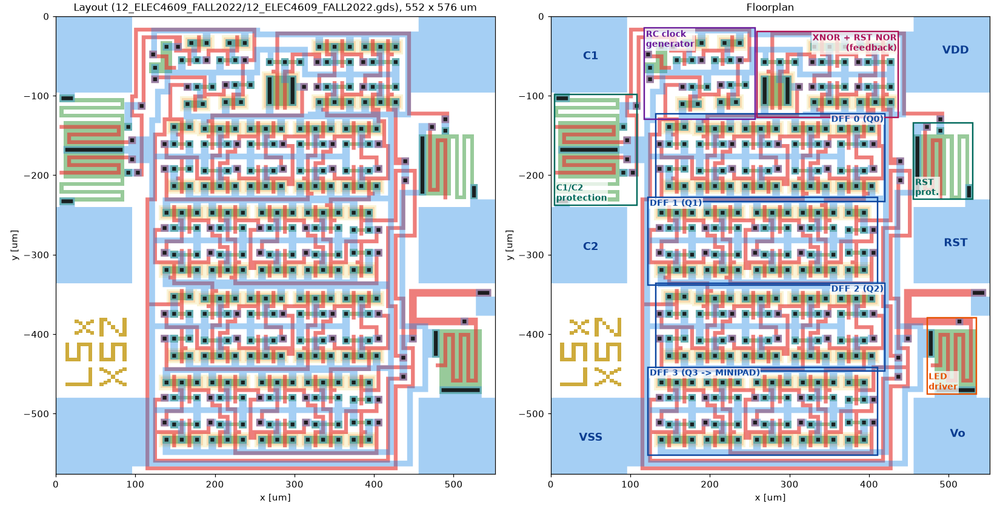
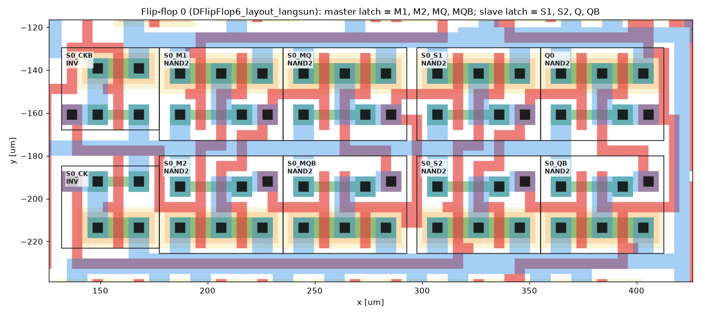

# Design

The circuit described here was recovered from the tape-out GDS
(`12_ELEC4609_FALL2022/12_ELEC4609_FALL2022.gds`) by the scripts in
[`analysis/`](../analysis), so it describes what was actually fabricated. The
original schematics live in the Cadence libraries `Libv2_langsun_4609fall2022`
(tape-out) and `Libv1_langsun_4609fall2022` at the repository root
([inventory](cadence_libraries.md)).

## 1. Specification (course handout)

Source: [`ELEC4609_Project_StaticPRSG_F2022.pdf`](../ELEC4609_Project_StaticPRSG_F2022.pdf)
(ELEC 4609 alternative project "Static Logic PRSG", v1.0).

- **Application:** a bicycle taillight controller that flashes an LED in an
  apparently random pattern, powered from 3 V (two AA cells).
- **Core:** a 5-bit pseudo-random sequence generator (PRSG): a shift register with
  XNOR feedback, period 2^5 - 1 = 31. If the static flip-flops do not fit,
  **4 stages are acceptable**.
- **Flip-flops:** textbook static master-slave D flip-flops built from NAND gates
  (Fig. 2 of the handout, 8 x NAND2 + 2 x INV = 36 transistors each) instead of
  the dynamic flip-flops of the baseline project, so no two-phase clock is needed.
- **Feedback:** XNOR from four NAND2s, with the final inverter replaced by a NOR
  so that `RESET = 1` forces a 0 into the register. This escapes the XNOR lock-up
  state (all ones).
- **Clock:** on-chip RC oscillator (Fig. 4): four inverters, an off-chip capacitor
  `C_ext` between pads C1 and C2 (10-500 nF), and a resistor-like NMOS M1 with
  gate tied to VDD and **L/W = 20**. An external clock can be injected at C2. Target
  flash rate ~10 Hz.
- **Output:** a wide open-drain NMOS that sinks **10 mA at V_DS = 1 V, V_GS = 3 V**
  to drive a red LED connected to VDD; an internal mini-pad on its gate gives
  probe access to the bit stream.
- **Floorplan:** a fixed frame **240 lambda high** with six 40 lambda pads (C1, C2, VSS
  on the left; VDD, RESET, VOUT on the right). Make the width as small as possible.

## 2. What was built

| Item | Specification | Implemented (from the GDS) |
|---|---|---|
| Register | 5 static DFFs (4 allowed) | **4** static NAND master-slave DFFs, so the period is **15** |
| Feedback | XNOR + NOR reset (Fig. 3b) | as specified; taps **Q0 and Q3**, D0 = NOR(XOR(Q0, Q3), RST) |
| Clock generator | 4 INV + M1 (L/W = 20) + C_ext | 4 INV + M1 drawn **W/L = 28.8/4.8 um** (short and wide) |
| Output driver | wide open-drain NMOS | NMOS **W/L = 321.6/4.8 um** (serpentine gate), gate = Q3 = MINIPAD |
| Pad protection | not specified | grounded-gate NMOS (W/L = 220.8/4.8 um) + diffusion resistor on C1, C2, RST |
| Frame | 240 lambda high, minimal width | **230 lambda x 240 lambda = 552 x 576 um** |
| Transistors | - | **177** (91 NMOS + 86 PMOS) |

Device sizes (KLayout extraction, `analysis/results/extraction_summary.md`):

| Device | W/L (um) | Count | Used in |
|---|---|---:|---|
| NMOS | 4.8 / 4.8 | 86 | all logic gates (2 lambda / 2 lambda) |
| PMOS | 9.6 / 4.8 | 84 | all INV/NAND2 pull-ups (2:1 P/N ratio) |
| PMOS | 38.4 / 4.8 | 2 | series pull-up of the RST NOR2 |
| NMOS | 28.8 / 4.8 | 1 | oscillator feedback device M1 |
| NMOS | 220.8 / 4.8 | 3 | pad protection (C1, C2, RST) |
| NMOS | 321.6 / 4.8 | 1 | open-drain LED driver |

## 3. Block diagram



## 4. Circuits

The full recovered gate-level netlist with net names is in
[`analysis/results/gate_level_netlist.txt`](../analysis/results/gate_level_netlist.txt).

### 4.1 RC clock generator

`C1 -> INV -> OSC1 -> INV -> C2 -> INV -> OSC3 -> INV -> PHI`, with M1 between C1
and OSC3 (gate tied to VDD) and `C_ext` off-chip between C1 and C2. This is the
classic two-inverter CMOS RC oscillator plus buffers, exactly the topology of
Fig. 4 in the handout. All four inverters are minimum size (Wn = 4.8 um, Wp = 9.6 um).
There is no hysteresis (no Schmitt trigger), so the switching point is just the
threshold of the first inverter.

M1 is drawn with a bent (L-shaped) gate, extracted as W/L = 28.8/4.8 um. That is
a low-resistance device, not the long-channel L/W = 20 resistor the handout
suggests. The Calibre LVS traced W and L with zero tolerance and still passed,
so the schematic used the same size; this was a design choice, not a layout slip.
The consequence is a higher frequency for a given `C_ext`. The chip measured
1.30 kHz with 10 nF, and scaling f ~ 1/C, the ~10 Hz flash target would need about
1.3 uF, well outside the 10-500 nF range the handout planned for
([post-fab results](post_fab_test.md#2-clock)).

### 4.2 Static master-slave D flip-flop

Each stage is the circuit of Fig. 2 in the handout (gate names as in the
recovered netlist, `k` = stage):

```
Sk_CKB = INV(PHI)                    Sk_CK  = INV(Sk_CKB)
master (transparent while PHI = 0)   slave (transparent while PHI = 1)
  Sk_M1  = NAND(D, Sk_CKB)             Sk_S1 = NAND(Sk_MQ, Sk_CK)
  Sk_M2  = NAND(Sk_M1, Sk_CKB)         Sk_S2 = NAND(Sk_S1, Sk_CK)
  Sk_MQ  = NAND(Sk_M1, Sk_MQB)         Qk    = NAND(Sk_S1, Sk_QB)
  Sk_MQB = NAND(Sk_MQ, Sk_M2)          Sk_QB = NAND(Qk, Sk_S2)
```

- Positive-edge triggered. On a rising PHI edge the master closes (CKB falls)
  one inverter delay before the slave opens (CK rises).
- Every flip-flop makes its own CKB/CK from PHI. There is no shared clock buffer,
  so PHI (one minimum inverter) drives four inverters across the core, mostly
  over poly ([4.6](#46-clock-distribution)).
- On a **falling** PHI edge the order reverses: CKB rises (the master opens) one
  inverter delay before CK falls (the slave closes), so both latches are briefly
  transparent. The latches are 2 NAND delays each, so this is normally harmless,
  but it is the weakest timing point of this textbook circuit when the clock edges
  are slow or noisy.
- The handout's dynamic baseline has a dedicated two-phase, non-overlapping clock
  generator. The static alternative saves it on purpose, so the only phase
  separation left is the local inverter pair above, driven by an RC oscillator
  without hysteresis. Both static designs on the run share this scheme
  ([post-fab results](post_fab_test.md#5-discussion)).

### 4.3 Feedback and sequence

```
X1 = NAND(Q0, Q3)   X2 = NAND(Q0, X1)   X3 = NAND(X1, Q3)
XOR = NAND(X2, X3)  D0 = NOR(XOR, RST)  ->  D0 = XNOR(Q0, Q3) when RST = 0
```

The register shifts D0 -> Q0 -> Q1 -> Q2 -> Q3, so the output obeys
`Q3[n+4] = XNOR(Q3[n+3], Q3[n])`, with characteristic polynomial x^4 + x^3 + 1. That
polynomial is primitive, so the sequence has maximal length:

```
Q3 after reset:  000101001101110 000101001101110 ...   (period 15: 7 ones, 8 zeros)
```

- **Lock-up:** 1111 maps to itself (XNOR(1, 1) = 1), and it is the only state
  that does. A fault-free register can therefore only be in 1111 if it powered up
  there. It can never enter 1111 from another state.
- **Reset:** RST = 1 forces D0 = 0. After 4 clocks the register is 0000, and on
  release it runs the 15-cycle above. The complete 16-state next-state table is in
  [`analysis/results/logic_simulation.md`](../analysis/results/logic_simulation.md).
- RST drives a NOR2 whose series PMOS pair is 4x the normal width (38.4 um), so
  its pull-up matches a single minimum PMOS with margin.

### 4.4 Output driver

A single open-drain NMOS (W/L = 321.6/4.8 um, about 67 squares, drawn as a
serpentine gate) pulls Vo low when Q3 = 1, which turns the LED on. Its gate is the
`MINIPAD` net, the Q output of the last slave latch, with **no buffer** in
between. The gate area (321.6 x 4.8 um) is about 22 NAND2 input loads. With the
other fan-out (S3_QB, X1, X3), the minimum-size NAND at the output of the last
slave latch drives about 25 NAND2 inputs, plus the mini-pad and routing. The
other latch outputs drive 2 to 4.

The instructor's annotations on the handout draw a buffer between the PRSG output
and this driver, and the course checklist asks for one ([5.4](#54-course-checklist)).

### 4.5 Pad protection

C1, C2 and RST each have a large grounded-gate NMOS (W/L = 220.8/4.8 um) to VSS
and a serpentine DWELL (diffusion) resistor. The resistors are not extracted as
devices (they are just conductive diffusion), and the Calibre LVS did not compare
them either: both netlists contain only MN/MP. Vo is protected only by the
driver transistor itself. VDD, VSS and the mini-pad have no dedicated protection.

### 4.6 Clock distribution



With a single metal layer, PHI is routed almost entirely in poly: 432 um² of
metal against 8,006 um² of poly wiring, about 350 squares of minimum-width poly
([`analysis/results/net_routing.md`](../analysis/results/net_routing.md)). The
supplies, for comparison, are all metal: about 42,000 um² each, with only gate
leads in poly.

The route leaves the clock generator at the top left and runs down the left side
of the core, with branches into DFF 0 and DFF 2. It then turns under the whole
core and climbs the right side to DFF 3 and finally DFF 1. The distance along the
wiring from the PHI driver to each flip-flop's clock inverter is generated by
`analysis/gate_level.py`:

| Flip-flop | Wiring from the PHI driver | ~Squares (4.8 um poly) | Fed by |
|---|---:|---:|---|
| DFF 0 | 78 um | 16 | feedback (D0) |
| DFF 2 | 364 um | 76 | DFF 1 |
| DFF 3 | 1,069 um | 223 | DFF 2 |
| DFF 1 | 1,389 um | 289 | DFF 0 |

So the clock runs the same way as the data for two of the four transfers:
DFF 0 → DFF 1 and DFF 2 → DFF 3. In both, the receiving flip-flop gets its edge
later than the one that feeds it. That is the hold-time-critical direction: if
the clock skew exceeds the sender's clock-to-Q delay (about four gate delays), new
data can pass through two stages on one edge.

The size of the skew depends on the poly sheet resistance and on the clock edge
rate. Neither can be checked here without the device models.

PHI also runs alongside `MINIPAD` (Q3) for most of that loop. Around the bottom
and up the right side, the two nets face each other at the minimum poly spacing
(4.8 um) for about 0.9-1.0 mm; that is by far the longest parallel run either net
has ([`net_routing.md`](../analysis/results/net_routing.md)). The coupling
capacitance of a few fF is small next to MINIPAD's ~2 pF of driver gate, so
ordinary crosstalk is not the concern. The concern is that this is where a
bridging defect would do the most harm: between the clock and the node that is
both the output and a feedback tap.

These are the most concrete layout-level links to the original retrospective
about the compact layout.

## 5. Layout



### 5.1 Process and layers

The chips were fabricated at Carleton, in the university's own SOI process (CUSOI).
The process facts below are paraphrased from the course's process-flow notes,
which are not included in this repository.

- **Starting wafer:** 100 nm p-type silicon film (2-4 x 10^16 cm^-3) on 400 nm of
  buried oxide. With a film this thin the devices are **fully depleted**, and the
  substrate underneath acts as a back gate. During testing it is biased (`Vsub`)
  to trim the thresholds.
- **Islands:** a poly-buffered LOCOS step grows 220 nm of field oxide that
  consumes the film between the device wells (DWELL), so every transistor sits on
  its own silicon island.
- **Gates:** 25 nm gate oxide (950 °C dry O2) and 350 nm LPCVD poly, doped n+ by
  phosphorus diffusion. NMOS and PMOS gates are patterned in two separate poly
  steps, and each step self-aligns its own source/drain doping: phosphorus for
  NMOS, then a boron implant (3 x 10^15 cm^-2) for PMOS. Both device types use
  n+ poly gates, and the film is p-type from the start; there is no well implant.
- **Thresholds:** a single blanket boron dose sets both thresholds, aiming for
  roughly +0.3 V (NMOS) and -0.3 V (PMOS). The substrate under the buried oxide
  shifts both thresholds in the same direction, so it can trim one device type
  only at the expense of the other.
- **Back end:** 100 nm undoped oxide + 500 nm BPSG, contacts, and **1 um of
  aluminium** patterned by lift-off.
- **Five masks:** D-well, poly 1 (NMOS gates), poly 2 (PMOS gates), contact,
  metal.

Design rules are scalable, with **lambda = 2.4 um**. That matches the GDS: every
coordinate is on a 2.4 um grid and the frame is 240 lambda = 576 um high. Minimum
gate length is 2 lambda = 4.8 um. Poly and DWELL are 2 lambda wide with 2 lambda
spacing; metal is 3 lambda / 3 lambda.

The GDS itself has no layer names. The mapping below was recovered by matching
per-layer polygon counts against the Calibre DRC summary and by geometry
(see [verification](verification.md#2-independent-re-extraction)):

| GDS layer | PDK layer | Use |
|---|---|---|
| 1/0 | DWELL | silicon island (device well, active area) |
| 2/0 | Pplus | marks PMOS source/drain (boron); always inside NWELL |
| 4/0 | NWELL | marks PMOS regions (separates the two poly / doping steps; no well implant) |
| 7/0 | POLY | gates and cross-unders |
| 6/0 | CONTACT | metal to poly / metal to DWELL |
| 5/0 | METAL | **the only metal layer** (1 um Al) |
| 1/999, 5/999, 7/999 | ART | artwork (initials), drawn on the DWELL, METAL and POLY layers |
| 230/0 | (text) | pad names in the frame cell |

With a single metal layer, every wire crossing needs a poly jumper. That is the
main reason the routing is as dense as it is, and why the clock ended up on poly
([4.6](#46-clock-distribution)).

### 5.2 Floorplan

| Block | Cell | Size / location |
|---|---|---|
| Frame + 6 pads (96 x 96 um each) | `SPRSG_Frame_langsun` | 552 x 576 um |
| Core (clock gen + XNOR + 4 DFFs) | `PRSG3_layout_langsun` | 355 x 557 um, centre column |
| RC clock generator | `clk_layout_langsun` | top-left of core |
| XNOR + RST NOR | `XNOR3_layout_langsun` | top-right of core |
| DFF 0 ... DFF 3 | `DFlipFlop6/5_layout_langsun` (alternating) | stacked top to bottom |
| C1/C2 protection | `input_protection_layout_langsun` | left, between C1 and C2 |
| RST protection | `input_protection3_layout_langsun` | right, between VDD and RST |
| LED driver | `outputBuffer_layout_langsun` | right, between RST and Vo |

- The two flip-flop cells are mirror images: `DFlipFlop5` has its clock inverters
  on the right, `DFlipFlop6` on the left. Stacking them alternately makes the data
  path snake down the core, so each Q sits next to the following D.
- Each flip-flop is 288 x 110 um: two rows of four NAND2 cells plus the two clock
  inverters.
- The ART layer carries the initials "LS × XSZ" on the left edge, between the C2
  and VSS pads: "LS" in poly, "×" in DWELL, "XSZ" in metal. See
  [the README](../README.md#the-art-on-the-die) for the die photo.



### 5.3 Cell hierarchy of the tape-out GDS

```
top_layout_langsun
|-- SPRSG_Frame_langsun                (pads + pad names)
|-- input_protection_layout_langsun    (C1, C2)
|-- input_protection3_layout_langsun   (RST)
|-- outputBuffer_layout_langsun
`-- PRSG3_layout_langsun
    |-- clk_layout_langsun             4 x inverter3_layout_langsun
    |-- XNOR3_layout_langsun           4 x NAND7_layout_langsun + NOR_layout_langsun
    |-- DFlipFlop6_layout_langsun  x2  4 x NAND6 + 4 x NAND7 + 2 x inverter2
    `-- DFlipFlop5_layout_langsun  x2  4 x NAND6 + 4 x NAND7 + 2 x inverter2
```

The numbered variants (NAND2...NAND7, DFlipFlop2...6, PRSG2/3, ...) are layout
iterations that are still in the library. Only the 15 cells above went into the
GDS; see [cadence_libraries.md](cadence_libraries.md) for the full inventory.

### 5.4 Course checklist

The instructor's annotations on the handout list five things to watch for (in
paraphrase below). Each was checked against the GDS:

| Checklist item | Result | Evidence |
|---|---|---|
| Keep routing off the pads | met | No poly, DWELL or contact inside any pad square; the only metal is each pad's own connection. |
| Supplies in metal only | met | Both rails are about 42,000 um² of metal. Their only poly is the gate lead of a device tied to the rail (M1 for VDD, the pad clamps for VSS). |
| Include the mini-pad (marks are deducted without it) | met | `MINIPAD` sits on the driver gate. |
| Buffer between the PRSG and the LED driver | **missed** | Q3 drives the 321.6 um driver directly ([4.4](#44-output-driver)). |
| Input protection on the pads | met | Clamps and resistors on C1, C2 and RST ([4.5](#45-pad-protection)). |
