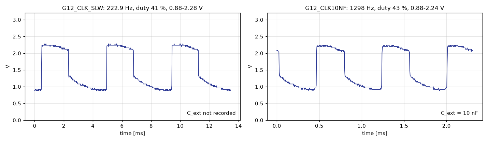
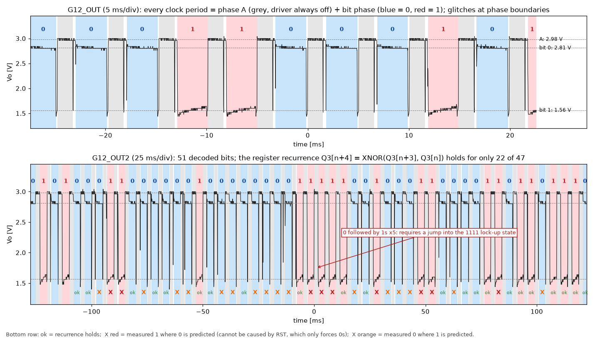
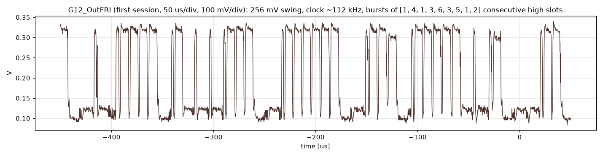

# Post-fabrication test

All numbers on this page are generated by [`analysis/scope.py`](../analysis/scope.py)
from the raw captures in [`post_fab_test/`](../post_fab_test/README.md). The full
generated summary is
[`analysis/results/post_fab_summary.md`](../analysis/results/post_fab_summary.md).

**Summary.** The die works at a basic level: the RC oscillator runs, its frequency
tracks `C_ext`, and the open-drain output switches once per clock. Two problems
show up in the data:

1. A clock-synchronous artifact forces the output off for about a third of every
   clock period and adds glitches.
2. The decoded bit stream does **not** follow the designed 15-bit sequence. It
   contains patterns that a fault-free register cannot produce, so the register
   state was being corrupted while these captures were taken.

The course's posted test data put this in context (section 5). The other
static-PRSG design on the same die did no better on the on-chip oscillator: its
output did not run at all. It produced a perfect sequence only once it was
re-tested with an external clock, and this chip never got that test. The most
likely main cause is therefore the on-chip clocking that both static designs
share. Layout details of this chip may have added to it, but the saved data
cannot separate the two.

## 1. What was measured

**Test setup.** This is reconstructed, in paraphrase, from the course notes and
the course web site. Neither is included in this repository:

- **Probing:** a probe station with one needle per pad ([photos](../G12C1.jpg)).
- **Supplies:** an HP 4155 semiconductor parameter analyzer provided VCC, RESET and
  GND, so RST was driven, not floating.
- **Clock capacitor:** `C_ext` across C1-C2.
- **Load:** the LED with a series resistor, from a supply to the Vo pad.
- **Scope probes:** 10x (1 MOhm, 10 pF) probes were used in the lab.
- **Substrate bias:** `Vsub` was set per die. The 2021 test log in the notes uses
  0, -2 and -3 V.

**Timeline:**

| Date (2022) | Event |
|---|---|
| Oct 15 | layout signed off (Calibre DRC/LVS); mask data then went to the University of Alberta for mask making |
| Nov 7 | chips expected around Nov 15-16; test window Nov 21 - Dec 2 |
| Nov 21 | the instructor reports that several PRBS designs show no clock, and that process variation is being compensated with the substrate bias. PRBS testing is set for the next day. A sketch shows clocks of about 1-1.5 kHz that start and then die out. |
| Nov 22 | PRBS testing. Three of the five captures here are from this session, taken right after the other static-PRSG chip's on the same scope |
| Dec 7-8 | additional tests, some with an externally injected clock (not of this chip) |

The scope was a Tektronix TDS2024C on channel 2, recording 2500 points per
capture. The channel's probe setting was 1x in every capture. The course posted
the same five captures for this chip, and they are numerically identical to the
files here.

| Folder | Scope date | Content | Time/div |
|---|---|---|---|
| `G12_OutFRI` | 19-Nov-22 | output, first session | 50 us |
| `G12_CLK_SLW` | (not shown) | clock, `C_ext` not recorded | 5 ms |
| `G12_OUT` | 22-Nov-22 | output | 5 ms |
| `G12_OUT2` | 22-Nov-22 | output, long record | 25 ms |
| `G12_CLK10NF` | 22-Nov-22 | clock, `C_ext` = 10 nF | 1 ms |

**Values that were not written down.** Where the data supports a reasonable
guess, it is listed below. These are inferences, not records.

| Unknown | Best inference | Basis |
|---|---|---|
| Logic supply | about 3 V | The handout specifies 3 V, and Vo's off level is 2.98 V. |
| LED supply and resistor | the LED supply was above 3 V | With the handout's LED model (IS = 4e-20 A, N = 2) on 3 V, Vo would sit near 1.4 V when the driver is off (the 1 MOhm scope path draws ~1.5 uA). The measured off level is 2.98 V. |
| Substrate bias `Vsub` | unknown | It shifts every threshold in this fully depleted process ([design 5.1](design.md#51-process-and-layers)). |
| Probed clock pad | most likely C2 | The capture is a square wave with sharp edges and a 1.3 V swing. The RC node C1 would instead jump by the full C2 step and then ramp exponentially back to the inverter threshold. |
| `C_ext` for `CLK_SLW` | about 58 nF | Scaling f ~ 1/C from the 10 nF capture. |
| Clock in the first session | about 0.1 nF equivalent | The same scaling at 112 kHz. This means a much smaller capacitor, parasitics only, or an injected clock. |
| RST level | low during the captures | It was driven by the HP 4155. A high RST would shift in 0s and hold the output at 0 after four clocks, but the output keeps toggling. The conclusions in section 3.3 do not depend on it either way. |

Without the LED supply and resistor values, the driver current cannot be checked
against the "10 mA at V_DS = 1 V" target.

## 2. Clock



| Capture | f | Duty (high) | High plateau | Low plateau | Vpp |
|---|---:|---:|---|---|---:|
| `CLK_SLW` | 222.9 Hz | 41 % | 2.24 -> 2.12 V | 1.24 -> 0.90 V | 1.40 V |
| `CLK10NF` (10 nF) | 1298 Hz | 43 % | 2.21 -> 2.08 V | 1.25 -> 0.92 V | 1.36 V |

- **The oscillator works and scales with `C_ext`.** If f ~ 1/C, `CLK_SLW`
  corresponds to roughly 58 nF.
- **It keeps running.** Neither the 50 ms nor the 10 ms record shows any decay. On
  this run that was not a given: the instructor noted several PRBS designs with no
  clock, and sketched clocks around 1-1.5 kHz that start and then die out. The
  10 nF result, 1.30 kHz, is in that range.
- **The frequency is high for the application.** Reaching the ~10 Hz flash rate
  would take about 1.3 uF, far above the 10-500 nF range in the handout. This
  follows from M1 being a short, wide device instead of the L/W = 20 resistor
  ([design 4.1](design.md#41-rc-clock-generator)).
- **The swing is not rail-to-rail, but that is normal for this circuit.** The
  waveform moves between roughly 0.9 and 2.25 V, and both plateaus sag during
  each half period: the probed node (most likely C2) is heavily loaded by tens of
  nF in series with M1. The other static-PRSG chip's clock captures on 19, 22 and
  24 Nov have the same shape and swing (1.32-1.36 V peak-to-peak). So this is a
  property of the oscillator and the measurement, not of this layout.

## 3. Output (Vo), 22 Nov



### 3.1 Waveform structure

Vo takes three well-separated levels:

| Level | Voltage | Meaning |
|---|---:|---|
| A | 2.98 V | present in **every** clock period, whatever the data |
| B0 | 2.81 V | rest of the period when Q3 = 0 |
| B1 | 1.56 V | rest of the period when Q3 = 1 (driver on) |

- **Every clock period has an A phase.** The period is about 4.97 ms (201 Hz). For
  about 1.5-1.7 ms of it (roughly a third), Vo sits at level A whatever the data.
  Only the remaining part shows the register bit.
- **For Q3 = 1 the driver is on only in the bit phase**, so the LED would be off
  for about a third of every period even during a run of 1s.
- **The two "off" levels differ:** Q3 = 0 gives 2.81 V, 0.17 V below level A.
- **Glitches** of 20-200 us, pulling toward the low level, appear at the phase
  boundaries (22 in `G12_OUT`, 50 in `G12_OUT2`).

### 3.2 Decoding

Samples are clustered into the three levels. Segments shorter than 0.4 ms
(glitches) are dropped, and each bit phase gives one bit. In both captures the
phases alternate strictly (A, bit, A, bit, ...), so there is exactly one bit per
clock period and no ambiguity about bit boundaries.

```
G12_OUT   (11 bits): 00011000101
G12_OUT2  (51 bits): 010100011000000100000000111110010001100001101101110
reference (designed, one period): 000101001101110
```

### 3.3 Does the bit stream match the register?

A fault-free register, with RST = 0, satisfies `Q3[n+4] = XNOR(Q3[n+3], Q3[n])`,
repeats every 15 bits, and never shows more than 4 zeros or 3 ones in a row.
For `G12_OUT2`:

| Test | Fault-free register | Measured |
|---|---|---|
| Recurrence holds | 47 / 47 | **22 / 47** (about chance level) |
| Violations with a measured 1 where 0 is predicted | 0 | **9** |
| Violations with a measured 0 where 1 is predicted | 0 | 16 |
| Repeats with period 15 | yes | no periodicity found |
| Longest run of 0s / 1s | 4 / 3 | **8 / 5** |
| Best alignment with the reference sequence | 0 mismatches | 21 of 51 |

These failures cannot be explained by a floating or noisy RST:

- RST can only force 0s into the register. The 9 cases of an unexpected **1**
  cannot come from RST.
- The stream contains **a 0 followed by five 1s**. Four consecutive 1s at Q3 mean
  the register held 1111. 1111 can only be reached from 1111 (see
  [design 4.3](design.md#43-feedback-and-sequence)), and the 0 just before
  shows it was in some other state. A fault-free register cannot do this with or
  without RST.

The decoding itself is robust. The levels are 1.25 V apart, the phase pattern
is perfectly regular, and one wrongly decoded bit could break at most 3
recurrence checks, while 25 fail. The short `G12_OUT` capture fails the same way
(4 of 7 checks hold).

**How often was the register upset?** For each fault model below, an exhaustive
search over every start state and every per-clock choice the model allows finds
the fewest fault events that reproduce the 51 bits:

| Fault model | Fewest events in 51 clocks |
|---|---:|
| RST pulses only | cannot reproduce |
| Hold-time races at DFF 1 and DFF 3 only | cannot reproduce (fails at the five 1s) |
| Races plus RST pulses | 20 |
| Missed or extra clock edges (0-3 shifts per period) | 16 |
| Arbitrary upsets of any register bits | 16 |

No model with only occasional faults fits. Whatever the mechanism, the register
was disturbed in roughly every third clock period.

**Conclusion:** during these captures the chip clocked its output once per
period, but the register was being upset, so it did not generate the designed
maximal-length sequence.

## 4. First session (19 Nov, `G12_OutFRI`)



- **Weak signal, possibly a probe-setting artefact.** The swing is only about
  0.2 V (levels 0.12 / 0.31 V, at 100 mV/div). The lab used 10x probes, while the
  scope channel was set to 1x, and a mismatch would make every reading exactly 10
  times too small. Scaled by 10, the levels become about 1.2 / 3.1 V, close to the
  1.56 / 2.98 V measured on 22 Nov. This was the first capture of the session
  (F0000). The other static-PRSG chip's captures about an hour later that night
  read normal levels, so if this is the explanation, the setting was corrected by
  then.
- **Much faster clock.** The spacing of the short dips gives a period of
  8.9 us (about 112 kHz), so the clock was probably injected externally or `C_ext`
  was much smaller. Neither is recorded.
- **Same structure as on 22 Nov:** a short phase in every period where the
  signal returns to the low level, plus glitches.
- **Impossible runs again.** There are bursts of up to 6 consecutive high slots and
  gaps of about 2-6 periods. With either polarity, this gives runs of 4 or more
  equal bits after the opposite value, which the fault-free register cannot
  produce (same lock-up argument). The slot grid is less regular in this capture,
  so this supports the 22 Nov result rather than standing on its own.

## 5. Discussion

**What the data shows:**

- The oscillator, the output driver and the flip-flops are alive.
- A disturbance locked to the clock phase blanks the output for a fixed part of
  every period and produces glitches.
- The register sequence is corrupted.

**Comparison with the other static-PRSG design.** Only two groups could take the
static-PRSG project. The other design sits on the same die and is about twice
this block's width. The course posted its captures from the same sessions and
the same scope, plus a later test. Those files are not included here:

| | This chip | Other static-PRSG chip |
|---|---|---|
| On-chip RC oscillator (19 and 22 Nov) | output toggles once per clock (1.56 / 2.81 V), sequence corrupted | no sequence: output parked at 2.0-2.3 V with 0.2-0.4 V of clock ripple |
| Clock waveform | 1.36-1.40 V peak-to-peak | 1.32-1.36 V peak-to-peak, same shape |
| External clock injected (December) | not tested | clean 0.40 / 2.97 V output; 49 decoded bits follow its 5-bit sequence in all 44 checks |

What this implies:

- **Both designs failed the same way.** Under identical conditions neither
  produced a valid sequence, and both show clock-synchronous artefacts on Vo. The
  other design was proven good only once it got a clean external clock. Its logic
  worked; the clock the chip made for it was the problem.
- **The common factor is the clocking.** Both designs use the handout's RC
  oscillator (no hysteresis) to drive single-phase static master-slave
  flip-flops, without the two-phase non-overlapping generator of the dynamic
  baseline ([design 4.2](design.md#42-static-master-slave-d-flip-flop)). Slow or
  noisy edges then cause missed or extra shifts and races. The fault-model fit
  above is consistent with this: missed or extra clock edges reproduce the stream
  as well as arbitrary upsets do.
- **The process is an unlikely main cause.** The course notes mention process
  variation being compensated with the substrate bias, and several PRBS designs
  without a clock. But the other static chip ran correctly on the same run once
  its clock was clean.
- **This chip's logic remains untested.** It never got an external clock, so
  whether its logic works on a clean clock is open.

**Layout factors that may have added to it.** These are facts from the GDS; their
effect is unverified:

1. **The clock is routed on poly, in the data direction.** PHI reaches DFF 1 and
   DFF 3 through about 1.4 and 1.1 mm of poly, after the stages that feed them
   ([design 4.6](design.md#46-clock-distribution)). That is a hold-time risk, and
   slow edges make it worse.
2. **The clock runs next to the output node.** PHI faces MINIPAD (Q3) at minimum
   spacing for about 0.9 mm ([design 4.6](design.md#46-clock-distribution)). That
   is the most exposed spot for a bridging defect, and it sits between the clock
   and the node that is both the output and a feedback tap.
3. **The last latch is unbuffered and heavily loaded.** Q3 drives the 321.6 um
   driver gate directly, about 25 NAND2 input loads. The course checklist asked
   for a buffer ([design 5.4](design.md#54-course-checklist)).

The original retrospective in the README blames the compact layout. The
comparison shows that the shared clocking problem came first; how much the
layout added on top of it is open. The supplies, at least, are on wide metal, so
on-chip IR drop on the rails is unlikely.

**What would have settled it:**

- Inject an external clock at C2 (allowed by the handout), as was done for the
  other chip.
- Probe the mini-pad (Q3) directly, to separate register errors from output-stage
  effects.
- Capture the clock and Vo at the same time on two channels (the TDS2024C has four).
- Record VDD, `Vsub`, the LED supply and resistor, the probe attenuation and
  `C_ext` with every capture.

## 6. Reproduce

```sh
uv run analysis/run_all.py      # rewrites analysis/results/post_fab_summary.md and docs/img/meas_*.png
```
