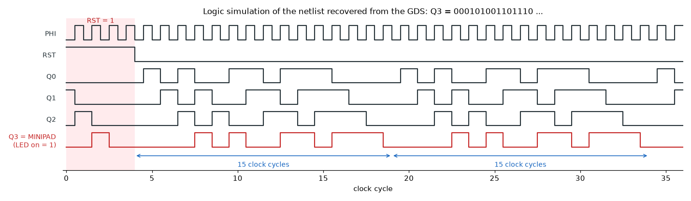

# Verification

There are two layers of verification here: the sign-off run at tape-out
(Calibre, in [`12_ELEC4609_FALL2022/`](../12_ELEC4609_FALL2022/README.md)) and an independent re-extraction of the
tape-out GDS with open-source tools (added later, in [`analysis/`](../analysis)).
The re-extraction is what makes it possible to say exactly what was fabricated,
because the Cadence OpenAccess databases cannot be read without Virtuoso.

## 1. Sign-off at tape-out (Calibre, 2022-10-15)

Calibre v2015.3_17.12 with the rule files of the Carleton SOI PDK, run on
2022-10-15 at 17:34, right after the last layout edit (17:33, see
[`12_ELEC4609_FALL2022/README.md`](../12_ELEC4609_FALL2022/README.md)).

### DRC: 0 violations

[`top_layout_langsun.drc.summary`](../12_ELEC4609_FALL2022/top_layout_langsun.drc.summary):
36 rule checks, **0 results**. The checks cover:

- width and spacing of METAL, POLY and DWELL
- contact size and its overlap by metal, poly and DWELL
- channel-to-contact spacing and field-poly rules
- NWELL/Pplus enclosure of DWELL and of the p+ source/drain
- three "bad gate" checks and seven grid checks
- separation of the ART layer from every device layer

| Layer | Shapes (hierarchical) | Shapes (flat) |
|---|---:|---:|
| METAL | 258 | 908 |
| CONTACT | 56 | 310 |
| DWELL | 102 | 474 |
| POLY | 365 | 778 |
| Pplus | 5 | 49 |
| NWELL | 5 | 49 |
| Nplus | 0 | 0 |
| ART | 45 | 45 |

### LVS: CORRECT

[`top_layout_langsun.lvs.report`](../12_ELEC4609_FALL2022/top_layout_langsun.lvs.report):
layout `top_layout_langsun` vs schematic `top_langsun`: **CORRECT**.

| | Layout | Source |
|---|---:|---:|
| Ports | 7 | 7 |
| Nets | 91 | 91 |
| MN (3-pin NMOS) | 91 | 91 |
| MP (3-pin PMOS) | 86 | 86 |
| After reduction / gate recognition | 36 `_nand2v`, 1 `_nor2v`, 10 `_invv`, 1 `_invx2v`, 5 MN | same |

- Transistor W and L were compared with zero tolerance
  (`TRACE PROPERTY mn/mp w/l 0`).
- `MINIPAD` and `VO` are labelled in the layout but named differently in the
  schematic. Calibre matched them by topology and lists them as "layout names
  missing in the source"; this is informational, not an error.

## 2. Independent re-extraction

Script: [`analysis/extract_netlist.py`](../analysis/extract_netlist.py) (KLayout
LVS engine).

**Layer mapping.** The GDS has numbers, not names. Matching per-layer shape
counts against the DRC summary identifies four layers outright:

| GDS layer | Shapes (hier / flat) | DRC summary | Name |
|---|---|---|---|
| 5/0 | 258 / 908 | METAL 258 (908) | METAL |
| 6/0 | 56 / 310 | CONTACT 56 (310) | CONTACT |
| 1/0 | 102 / 474 | DWELL 102 (474) | DWELL |
| 7/0 | 365 / 778 | POLY 365 (778) | POLY |
| 1/999 + 5/999 + 7/999 | 9 + 29 + 7 | ART 45 | ART |
| 2/0, 4/0 | 5 / 49 each | Pplus, NWELL: 5 (49) each | see below |

Layer 2 lies entirely inside layer 4, and both cover exactly the 86 PMOS gates,
so 2 = Pplus and 4 = NWELL.

**Device rules.** gate = POLY AND DWELL. A gate inside Pplus is PMOS, otherwise
NMOS. Source/drain = DWELL NOT POLY. Devices are 3-terminal (SOI, floating
body), like Calibre's `MN/MP (3 pins)`. The connectivity stack is METAL -
CONTACT - {POLY, source/drain}, and pin names come from the METAL text labels.

**Result.** The extraction reproduces the Calibre numbers exactly
([`analysis/results/extraction_summary.md`](../analysis/results/extraction_summary.md)):

| Object | KLayout | Calibre layout | Calibre source |
|---|---:|---:|---:|
| Ports | 7 | 7 | 7 |
| Nets | 91 | 91 | 91 |
| NMOS | 91 | 91 | 91 |
| PMOS | 86 | 86 | 86 |

The flat SPICE netlist is
[`analysis/results/top_layout_langsun.extracted.sp`](../analysis/results/top_layout_langsun.extracted.sp).

The same extraction also reports which layers carry the key nets
([`analysis/results/net_routing.md`](../analysis/results/net_routing.md)). VDD and
VSS are wide metal. The clock PHI is almost entirely poly
([design 4.6](design.md#46-clock-distribution)).

## 3. Gate-level recovery

Script: [`analysis/gate_level.py`](../analysis/gate_level.py).

Transistors are grouped into static CMOS gates:

- INV: a PMOS to VDD and an NMOS to VSS sharing the same gate
- NAND2: two parallel PMOS to VDD plus a series NMOS pair to VSS
- NOR2: the dual of NAND2

Nets are then named by tracing the structure from the pads (oscillator ->
PHI -> flip-flops -> feedback), not from the extractor's auto-generated names.

| | Count | Transistors |
|---|---:|---:|
| INV | 12 (4 oscillator + 2 x 4 flip-flops) | 24 |
| NAND2 | 36 (8 x 4 flip-flops + 4 XNOR) | 144 |
| NOR2 | 1 (reset) | 4 |
| Discrete NMOS | 5 (M1, LED driver, 3 pad clamps) | 5 |
| **Total** | | **177** |

Calibre's gate recognition reports 10 `_invv` + 1 `_invx2v` (a 4-transistor
inverter object) where this script finds 12 inverters. The transistor totals
agree.

The result is [`analysis/results/gate_level_netlist.txt`](../analysis/results/gate_level_netlist.txt).
Every flip-flop traces to the expected 10-gate master-slave structure, the
chain is D0 -> Q0 -> Q1 -> Q2 -> Q3 = MINIPAD, and the feedback taps are Q0 and Q3.

## 4. Logic simulation

Also in [`analysis/gate_level.py`](../analysis/gate_level.py). This is a
unit-delay simulation of the recovered gates, with the four oscillator inverters
removed and PHI driven directly (equivalent to injecting a clock at C2). Unit
delay keeps the order of each flip-flop's local CKB/CK inverters. The latches'
symmetric power-up state is resolved by one initial relaxation pass.

Results ([`analysis/results/logic_simulation.md`](../analysis/results/logic_simulation.md)):

- After RST, Q3 = `000101001101110`, repeating every **15** cycles (7 ones,
  8 zeros), as expected for x^4 + x^3 + 1.
- **Exhaustive next-state table:** with RST = 0, the 15 states from 0000 form a
  single cycle and **1111 is the only fixed point** (lock-up). With RST = 1, every
  state shifts a 0 into Q0, including 1111, so reset always escapes lock-up.

So the fabricated layout implements the intended 4-bit maximal-length PRSG, at
least at the logic level.

## 5. What this does not cover

- **No transistor-level simulation.** The PDK device models are not in this
  repository, so the oscillator, the drive strength of the output stage, and
  timing (clock overlap, setup/hold) cannot be re-simulated here.
- **Protection resistors** (serpentine DWELL) are treated as wires, as in the
  original LVS.
- The unit-delay model checks logic and clock-phase ordering only, not analog
  effects such as slow clock edges, supply bounce or coupling. These are the
  suspects for the silicon behaviour described in
  [post-fab results](post_fab_test.md).
